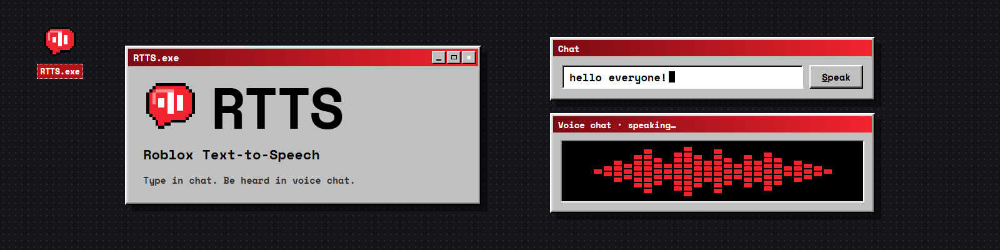
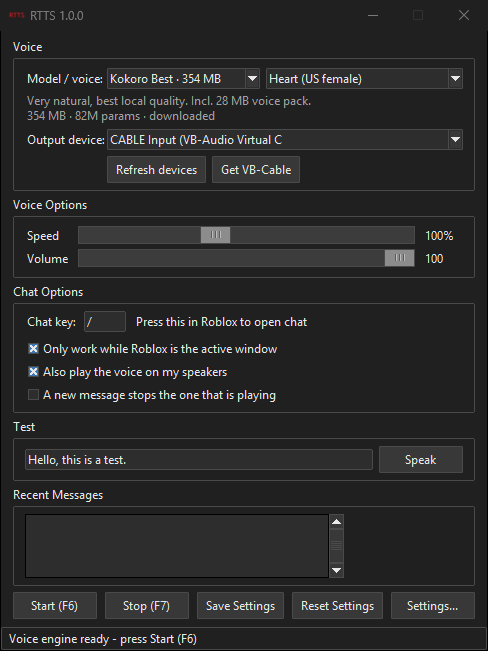
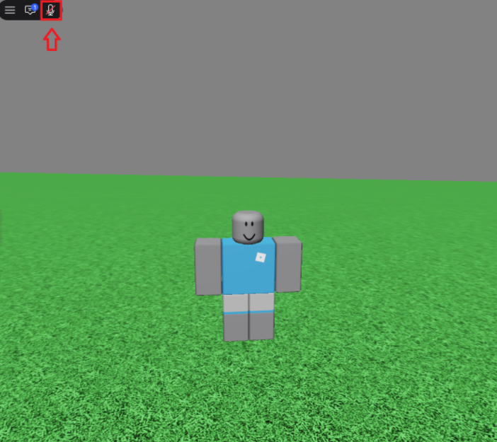
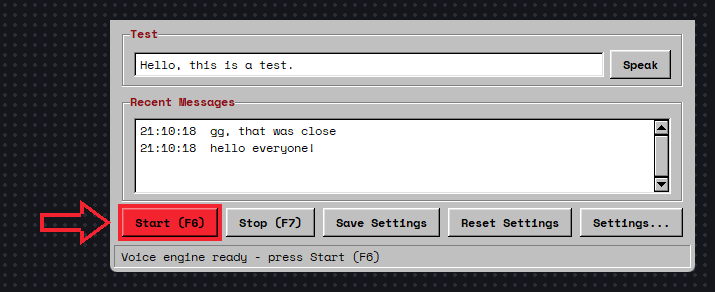
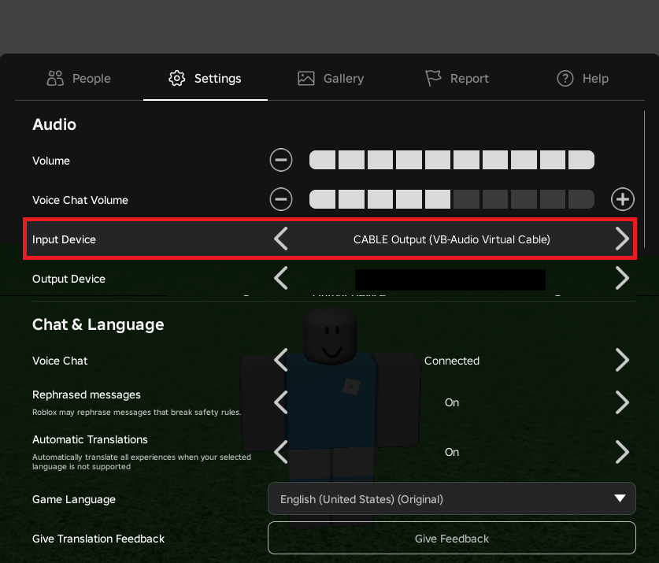
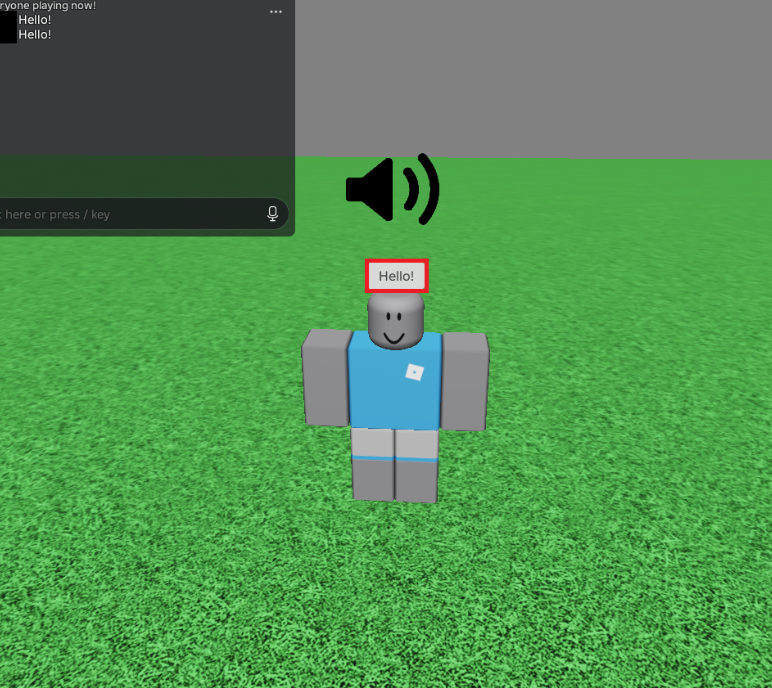

  <a href="../../releases/latest"><b>Download for Windows</b></a> · <a href="docs/images/demo.gif">Watch the video guide</a>

> [!WARNING]
> **This GitHub page is the only official place to download RTTS.** Copies anywhere else may contain malware. [Read more](#only-download-rtts-from-here)

---

## What is RTTS?

**Type in Roblox chat, and RTTS says it out loud in voice chat.** No mic, no talking.

- **100% local:** every voice runs on your PC. No account, no API key.
- **Robotic to realistic:** 7 voice models, from tiny eSpeak to ⚡ Orpheus.
- **9 languages:** English, Spanish, French, Portuguese (Brazil), German, Hindi, Russian, Arabic and Chinese, for both the voice and the app itself.
- **Roblox hears it as your mic:** the voice plays through [VB-Cable](https://vb-audio.com/Cable/).
- **Stays up to date:** checks for a new version every time it starts.
- **Your colours:** a retro look with 7 colour themes, or pick your own in **Settings > Appearance**.

## Why local?

Most text-to-speech tools send your text to a server, wait for the audio and download it. RTTS makes every voice on your own PC instead. That's better in a few ways:

- **Less delay.** Nothing travels across the internet, so you don't wait on a server or your connection. When you press Enter, your PC starts talking right away. Bad Wi-Fi or a busy server never slows it down.
- **Privacy.** Your messages never leave your PC. No company gets a copy of what you type, so nothing can be logged, read, sold or leaked (see [Privacy](#privacy)).
- **Security.** There's no account to hack, no password to steal and no API key to leak. RTTS never asks you to log in to anything.
- **Free forever.** Online voices often charge per message or limit how much you can say. Local voices cost nothing to run, so you can talk as much as you like.
- **Works without internet.** Once a voice is downloaded, it keeps working even if you go offline. RTTS only needs the internet to download voices and check for updates.
- **Nothing can be taken away.** If an online service shuts down, changes its price or removes a voice, apps that use it stop working. Voices on your PC stay yours.

**The trade-off:** voices take up space on your PC (from a few MB up to a few GB), and your PC does the work. Most voices run fine on almost any PC, but the biggest one, ⚡ Orpheus, needs a strong graphics card (see the [FAQ](#faq)).

## AI use

**The code.** RTTS was made using AI, and AI was heavily used to write the code, mostly with [Claude](https://claude.com/claude-code) by Anthropic. The full source is right here if you want to see how it works.

**The voices.** RTTS uses AI voice models to do the talking. Kokoro, Piper and Orpheus are AI models, while eSpeak is a classic robotic voice that isn't AI.

**Your messages.** AI only turns your text into speech. It doesn't change, rewrite or reply to anything you type. RTTS says exactly what you wrote.

**Where the AI runs.** Every voice runs on your own PC, so your messages never leave it (see [Privacy](#privacy)).

## Only download RTTS from here

The **only** official download is the [Releases](../../releases/latest) page of this GitHub repo: **github.com/CepsiPola/RTTS**. RTTS is never uploaded anywhere else.

Roblox tools are often re-uploaded with malware added, so **don't download RTTS from**:

- Discord servers or DMs
- YouTube or TikTok descriptions and comments
- File hosts: MediaFire, MEGA, Google Drive, Dropbox, OneDrive, WeTransfer
- Download sites: Softonic, Uptodown, FileHippo, SourceForge, CNET Download and similar
- Reddit, Telegram, forums or itch.io
- Roblox games, groups, profiles or messages
- Other GitHub repos or forks that offer their own download

If you got RTTS anywhere else, delete it and download it again from here.

**Signs of a fake:**

- It asks for your Roblox password, login, cookie or 2-step code. **RTTS never does.**
- It tells you to turn off your antivirus or Windows Defender. **RTTS never does.**
- It costs money, or wants you to complete a survey or "unlock" it. **RTTS is free.**
- It comes as a password-protected .zip or .rar, or as anything other than `RTTS-Setup-<version>.exe`.

**Check your download:** each release lists the SHA-256 checksum of its installer. In PowerShell, run `Get-FileHash RTTS-Setup-<version>.exe` in the folder you downloaded it to. If the result doesn't match the release page, don't run it.

**Found a fake?** Please report it on the site where you found it, and [open an issue](../../issues) here so others can be warned.

## How to set up RTTS

First, install VB-Cable from [vb-audio.com/Cable](https://vb-audio.com/Cable/). Restart your computer when it asks you to.

Next, download `RTTS-Setup-<version>.exe` from [Releases](../../releases/latest) and run it. The installer checks for VB-Cable, and lets you pick voices to download right away. Installing a new version over an old one keeps your voices and settings.

Open RTTS and set **Output device** to **CABLE Input**. If you didn't pick a voice in the installer, RTTS downloads one the first time it opens (a few hundred MB), so give it a minute. You can switch voices any time from the menu in the app.

## How to use RTTS

▶ **[Watch the 1-minute video guide](docs/images/demo.gif)** (a GIF, no sound), or follow the steps below.

Voice chat has to be turned on for your Roblox account.

**1. Come off mute in Roblox.** Click the microphone at the top left of the screen so it isn't crossed out.

**2. Press Start in RTTS.** Click **Start (F6)**, or press F6. Press **Stop (F7)** when you're done. You can change both keys in **Settings > Keybinds**.

**3. Make sure Roblox is listening to VB-Cable.** In Roblox, press Esc, go to **Settings**, and set **Input Device** to **CABLE Output (VB-Audio Virtual Cable)**.

**4. Type in chat.** Press `/`, type your message and press Enter. It shows in chat as normal, and RTTS says it out loud in voice chat.

**Tips**

- **Test without Roblox:** type in the **Test** box in RTTS and click **Speak**.
- **Hear it yourself:** keep **Also play the voice on my speakers** ticked.
- **Nobody can hear you?** Check that RTTS's **Output device** is **CABLE Input**, Roblox's **Input Device** is **CABLE Output**, you're not muted in Roblox, and RTTS says "Running".

## Privacy

RTTS reads your keyboard only to see what you type in chat, and by default only while Roblox is the active window. The code is public, so you can check.

Every voice runs on your PC, so your messages are never sent anywhere. RTTS needs no account or API key. It only uses the internet to download voices, to ask GitHub if there's a newer version of RTTS when it starts, and to send anonymous voice stats if you turn them on (see below). Nothing you type is sent.

Orpheus runs in a helper program (llama.cpp's `llama-server`) that RTTS starts on your PC. It only accepts connections from your own computer, and RTTS closes it when you switch models or close RTTS.

### Anonymous voice stats

RTTS can send which voice you use (for example "Kokoro: af_heart"), so I can see which voices are popular and which are worth improving. It's **off unless you tick it**: the installer has an unticked "Send anonymous stats about which voice I use" box, and you can turn it on or off anytime in Settings > General > About and updates. Updates never change your choice.

That is the only thing it sends. It never sends what you type, what you hear, your Roblox username, your keybinds, your files, or anything that identifies you or your PC. Your IP address isn't stored or used to look up your location, and each launch gets a new random ID, so launches can't be linked together.

## FAQ

**Windows says "Windows protected your PC".**
The installer isn't code-signed. Click **More info**, then **Run anyway**. Only download RTTS from this repo's Releases.

**My antivirus flags it.**
Some antivirus programs may flag it because it listens to what you type, which is also what malware called keyloggers does. RTTS only reads what you type while Roblox is the active window, and the full source is in this repo so anyone can check.

**Orpheus is slow, or my game lags while it speaks.**
Orpheus needs a strong graphics card. If yours struggles, pick Kokoro Best instead. It still sounds very natural and runs on almost any PC.

**Something went wrong.**
Most errors are saved in `%APPDATA%\RTTS\error.log`. If you report a bug, please include that file.

**How do I update?**
RTTS checks for a new version every time it starts and asks if you want to update. To update without being asked, turn on **Install updates automatically** in **Settings > General > About and updates**.

**How do I make it speak another language?**
In the main window, pick it under **Voice > Language**. Only the models and voices that speak that language are listed, and RTTS tells you which models can't. To show RTTS itself in another language, use **Settings > General > Language**.

| Language | Voices |
|---|---|
| English | eSpeak, Piper, Kokoro, ⚡ Orpheus |
| Spanish | eSpeak, Piper Medium and High, Kokoro |
| French, Portuguese (Brazil), Hindi | eSpeak, Piper Medium, Kokoro |
| German | eSpeak, Piper Low, Medium and High |
| Russian, Chinese | eSpeak, Piper Medium |
| Arabic | Piper Medium |

Type in Roblox with that language's keyboard layout (for example Russian or Arabic) and RTTS reads it. Chinese typed with an input method like Pinyin can't be read, because RTTS only sees the Latin letters you press: paste your message into the chat with Ctrl+V instead.

**Does it work on Mac or Linux?**
No, it's Windows only for now.

## Build it yourself

You need Windows and Python 3.10 or newer (tick *Add python.exe to PATH* and *tcl/tk* when installing).

Run `installer.bat` to install the Python libraries RTTS needs (it doesn't install the app). Use `start.bat` to run RTTS straight from the source, `build.bat` to build `dist\RTTS\RTTS.exe`, and `make_installer.bat` to build `installer_output\RTTS-Setup-<version>.exe` (set the version at the top of `RTTS.iss`), which needs [Inno Setup 6](https://jrsoftware.org/isdl.php).

## Credits

RTTS is built on great open-source work: [Kokoro](https://huggingface.co/hexgrad/Kokoro-82M) and [kokoro-onnx](https://github.com/thewh1teagle/kokoro-onnx), [Piper](https://github.com/rhasspy/piper) and [piper-voices](https://huggingface.co/rhasspy/piper-voices), [espeak-ng](https://github.com/espeak-ng/espeak-ng), [Orpheus TTS](https://github.com/canopyai/Orpheus-TTS) by Canopy Labs (using [Unsloth's GGUF version](https://huggingface.co/unsloth/orpheus-3b-0.1-ft-GGUF)), [llama.cpp](https://github.com/ggml-org/llama.cpp), [SNAC](https://github.com/hubertsiuzdak/snac) (using the [ONNX version](https://huggingface.co/onnx-community/snac_24khz-ONNX)), and [VB-Cable](https://vb-audio.com/Cable/). Each project has its own license, so check them before redistributing anything.

## Disclaimer

RTTS is an independent project. It is **not affiliated with, endorsed by, or sponsored by Roblox Corporation**. "Roblox" is a trademark of Roblox Corporation. Use RTTS in line with Roblox's rules.

## License

See the [LICENSE](LICENSE) file.